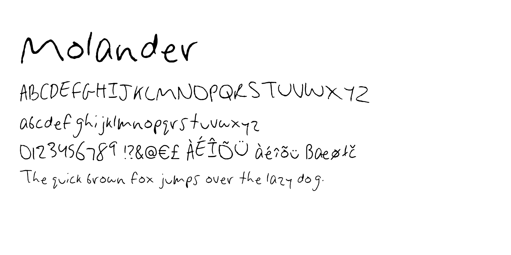

# Molander

Molander is a casual handwritten typeface by Jab Bonstein. Every letter is traced from one sheet of real pen-on-paper handwriting (`sources/handwriting-sheet.png`), with the stroke weight evened out so it reads consistently at any size.



## Character set

Google Fonts **Latin Core**: A–Z, a–z, 0–9, common punctuation and symbols, and accented letters for most Western and Central European languages.

## Building

Fonts are built with [gftools builder](https://github.com/googlefonts/gftools):

```bash
pip install -r requirements.txt
cd sources && gftools builder config.yaml
```

`sources/Molander.glyphs` is the master source. `tools/` contains the scripts used to trace the original handwriting sheet into it.

## License

This Font Software is licensed under the SIL Open Font License, Version 1.1. See [OFL.txt](OFL.txt). The license is also available with a FAQ at https://openfontlicense.org
